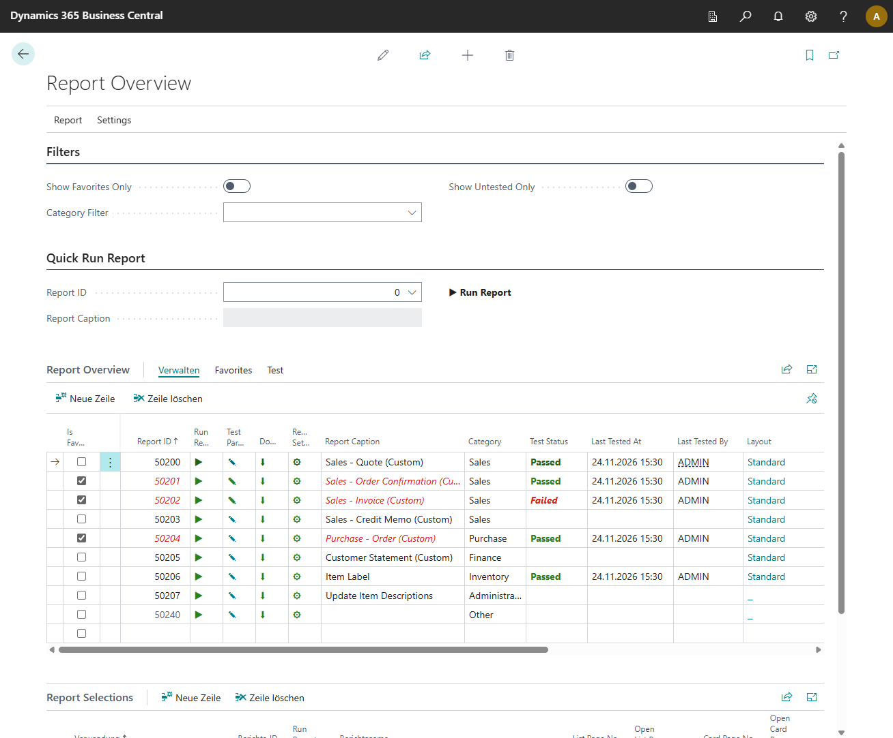
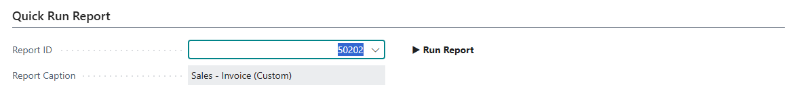
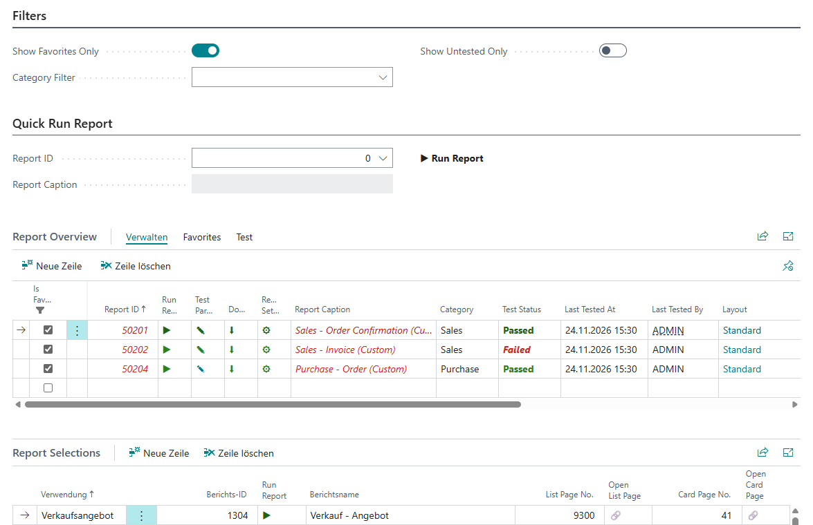
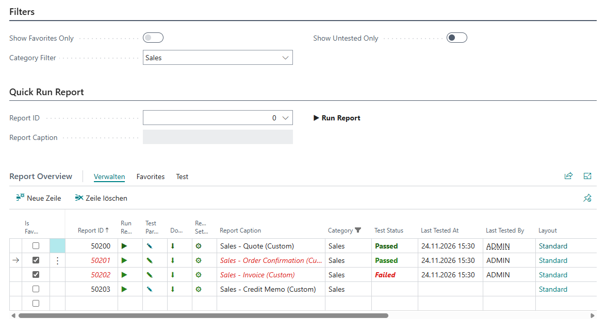
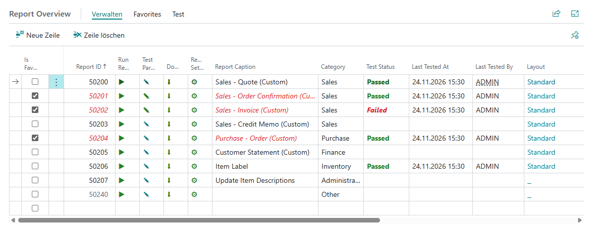
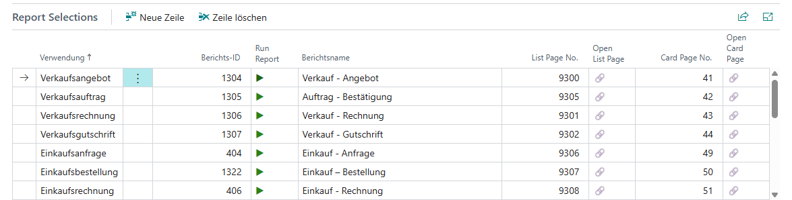
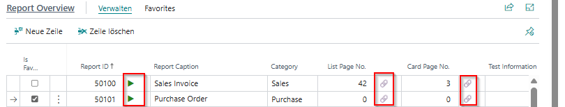

# 📊 Report Overview for Microsoft Dynamics 365 Business Central

A powerful and intuitive extension for managing, organizing, and executing custom reports in Microsoft Dynamics 365 Business Central. This extension provides a centralized dashboard for all your custom reports with advanced filtering, favorites management, and quick-access navigation.


*Main Dashboard with Quick Run Report, Filters, and integrated Subpages*

---

## 🚀 Features

### 📋 **Report Management Dashboard**
- **Centralized Overview**: Single page to view all custom reports (ID range 50000-100000)
- **Quick Run Report**: Execute any report directly from the dashboard without navigation
- **Inline Actions**: Run reports and open related pages with one-click inline buttons (▶ and 🔗)
- **Smart Filtering**: Filter reports by favorites and categories
- **Auto-Population**: Automatically discovers and lists all custom reports in your environment


*Quick Run Report feature with inline execution button*

### ⭐ **Favorites System**
- Mark frequently used reports as favorites with a single click
- Visual highlighting of favorite reports with attention styling
- Quick filter to show only favorite reports
- Add/Remove favorites directly from the list


*Favorite reports with visual highlighting and filter options*

### 🏷️ **Report Categorization**
- Organize reports into logical categories:
  - **Sales** - Sales-related reports
  - **Purchase** - Purchasing and procurement reports
  - **Finance** - Financial reports and statements
  - **Inventory** - Stock and inventory reports
  - **Manufacturing** - Production and manufacturing reports
  - **Service** - Service management reports
  - **Human Resources** - HR and employee reports
  - **Administration** - Administrative reports
  - **Other** - Miscellaneous reports
- Filter reports by category with dropdown selection
- Extensible enum for adding custom categories


*Category dropdown and filtering in action*

### 🎯 **Quick Navigation**
- **Inline Run Buttons (▶)**: Execute reports directly from the list with visual feedback
- **Inline Page Links (🔗)**: Open associated list or card pages instantly
- **Report Selections Integration**: View and manage standard BC report selections
- **Direct Access**: Navigate to Report Selection Sales/Purchase and Company Information

### 📊 **Two Integrated Subpages**

#### 1. **Report Overview Subpage**
- Lists all custom reports with full details
- Editable fields for report metadata:
  - Report ID and Caption
  - List Page No. and Card Page No.
  - Category assignment
  - Custom notes/information
- Favorite toggle with visual feedback
- Inline action buttons for quick execution


*Custom reports list with inline ▶ Run and 🔗 Link buttons*

#### 2. **Report Selections Subpage**
- Pre-filtered standard BC report selections (Sales & Purchase)
- Supported document types:
  - Purchase: Quote, Order, Invoice, Credit Memo
  - Sales: Quote, Order, Shipment, Invoice, Pro Forma Invoice, Credit Memo
- Automatic page number resolution for list and card pages
- Inline buttons for running reports and opening pages


*Standard BC Report Selections with inline execution and navigation*

---

## 📦 Installation

### Prerequisites
- Microsoft Dynamics 365 Business Central (Cloud)
- Platform version: 29.0.0.0 or higher
- Runtime: 18.0 or higher
- Object ID range: 50100-50149 available

### Installation Steps
1. Download the `.app` file from the releases section
2. Open Business Central Administration Shell
3. Run: `Publish-NAVApp -ServerInstance BC -Path "path-to-app-file.app"`
4. Install via Extension Management in Business Central
5. Assign the "Report Overview" permission set to users

---

## 🎯 Usage Guide

### Opening the Report Overview
1. Search for **"Report Overview"** in the Business Central search (Alt+Q)
2. The page will automatically populate with all custom reports

### Quick Run Report
1. Enter a **Report ID** in the "Quick Run Report" section
2. The report caption will be displayed automatically
3. Click the **▶ Run Report** button to execute immediately

### Managing Favorites
1. Navigate to the **Report Overview Subpage**
2. Check the **"Is Favorite"** checkbox for reports you use frequently
3. Use the **"Show Favorites Only"** filter to see only marked reports
4. Alternative: Use the **Actions menu** → **Favorites** → **Add to Favorites**

### Categorizing Reports
1. Select a report in the **Report Overview Subpage**
2. Choose a category from the **Category** dropdown
3. Use the **"Category Filter"** on the main page to filter by category

### Using Inline Buttons
- **▶ Button**: Click next to any Report ID to run the report instantly
- **🔗 Button**: Click next to List/Card Page No. to open the associated page
- Visual feedback: Buttons are highlighted when the target is valid (non-zero)


*Inline action buttons with visual feedback for quick access*

### Filtering Reports
- **Show Favorites Only**: Toggle to display only favorite reports
- **Category Filter**: Select a category to filter reports
- **Show All Reports** action: Clears all filters instantly

### Accessing Standard Report Selections
1. View pre-filtered selections in the **Report Selections Subpage**
2. Run standard reports directly with inline ▶ buttons
3. Open related document list/card pages with inline 🔗 buttons
4. Navigate to full Report Selection pages via the Settings actions

---

## 🏗️ Technical Details

### Object Structure

| Object Type   | Object ID | Object Name               | Description                                        |
| ------------- | --------- | ------------------------- | -------------------------------------------------- |
| Table         | 50100     | Report Test               | Stores custom report metadata and user preferences |
| Enum          | 50100     | Report Category           | Categorization options for reports                 |
| Page          | 50100     | Report Overview           | Main dashboard (Card Page)                         |
| Page          | 50102     | Report Overview Subpage   | Custom reports list (ListPart)                     |
| Page          | 50101     | Report Selections Subpage | Standard report selections (ListPart)              |
| Codeunit      | 50100     | Report Overview Mgt.      | Business logic and report management               |
| PermissionSet | 50100     | Report Overview           | Grants access to all extension objects             |

### Key Features Implementation

#### Report Auto-Discovery
- Scans `AllObjWithCaption` for reports in range 50000-100000
- Auto-populates the `Report Test` table on page open
- Uses FlowFields for dynamic report caption lookup

#### Filter Architecture
- Main page filter controls trigger `ApplyFilters()` procedure
- Calls `SetFilters()` on subpage with filter parameters
- Subpage applies `Rec.SetRange()` for efficient filtering

#### Inline Button Pattern
- Small-width fields (Width=1) with symbol characters (▶, 🔗)
- Non-editable with DrillDown triggers
- Conditional styling with `StyleExpr` for visual feedback
- Favorable style for active/valid targets

#### Permission Model
- Single assignable permission set
- Execute (X) permissions for codeunits, pages, and reports
- RIMD (Read, Insert, Modify, Delete) for table data

---

## 🔧 Configuration

### Extending Report Categories
The `Report Category` enum is marked as extensible. To add custom categories:

```al
enumextension 50100 "My Report Categories" extends "Report Category"
{
    value(50100; "My Custom Category")
    {
        Caption = 'My Custom Category';
    }
}
```

### Customizing Object Range
To scan a different report ID range, modify the `FillTestTable()` procedure in codeunit 50100:

```al
AllObjWithCaption.SetRange("Object ID", YourStartID, YourEndID);
```

---

## 🛠️ Development Notes

### Repository Layout
- `app/`: the extension (object IDs 50100-50149, namespace `ReportOverview`)
- `test/`: the automated tests as a separate app (object IDs 50150-50199, namespace `ReportOverview.Test`)
- `Report-Overview.code-workspace`: open this file in VS Code to work with both apps

### Automated Tests
- 57 tests in three test codeunits cover the business logic (page mapping, report discovery, report captions, report settings), the pages (filters, Quick Run Report, inline buttons, editing lines, favorites, report selections, navigation actions) and the permission set
- The test app depends on the Microsoft apps `Library Assert` and `Permissions Mock` and needs a sandbox or container with the Microsoft test framework. Run the tests only in a test environment: they clear the report list during the run
- Publish `app`, then `test`, and run the tests from the VS Code Test Explorer
- The test app contains the reports `Report Overview Test Report` (50150) and `Test Report With Request Page` (50151). While the test app is installed, these reports show up in the Report Overview. Report 50150 has no request page and no output, so running it shows nothing; report 50151 opens a request page

### Code Quality
- **No compilation warnings or errors**
- NoImplicitWith feature enabled
- Namespaces in all objects
- All fields and actions have descriptive ToolTips
- Reduced cyclomatic complexity (<8) in all procedures
- Follows AL coding best practices

### Design Patterns
- **Dashboard Pattern**: Main Card page without SourceTable for pure overview
- **ListPart Integration**: Embedded subpages with filter propagation
- **Inline Actions**: User-friendly button placement for efficiency
- **FlowFields**: Dynamic data loading for performance
- **Procedure-based Filtering**: Explicit filter control between pages

---

## 📝 Customization Examples

### Adding Custom Information to Reports
1. Navigate to the **Report Overview Subpage**
2. Enter text in the **"Test Information"** field
3. Information is stored per report and persists across sessions

### Linking Reports to Pages
1. Find the Page ID for your list or card page
2. Enter the ID in **"List Page No."** or **"Card Page No."**
3. Use the inline 🔗 buttons to navigate directly

---

## 🤝 Contributing

This is an open-source Business Central extension. Contributions are welcome!

### Ways to Contribute
- Report bugs or request features via GitHub Issues
- Submit pull requests with improvements
- Share your customizations and extensions
- Improve documentation

---

## 📄 License

This project is licensed under the MIT License - see the LICENSE file for details.

---

## 🙏 Acknowledgments

- Built for the Microsoft Dynamics 365 Business Central community
- Designed with user experience and efficiency in mind
- Inspired by the need for better report management in BC projects

---

## 📞 Support

For questions, issues, or feedback:
- Create an issue on GitHub
- Check existing documentation and issues first
- Provide detailed information about your BC version and setup

---

**Made with  for the Business Central Community**

For version history and changelog, see [CHANGELOG.md](CHANGELOG.md)
